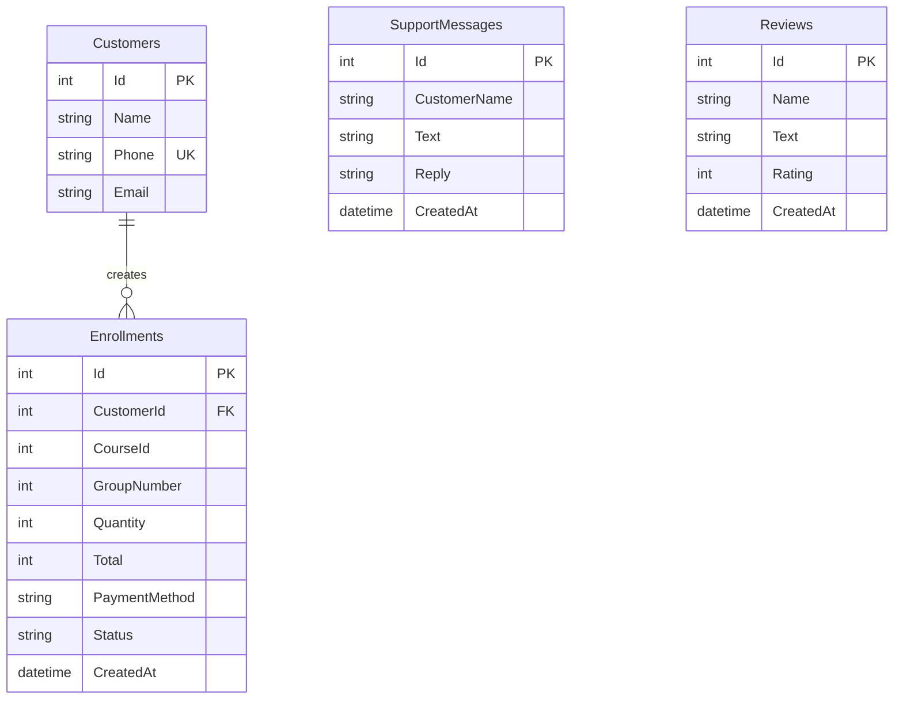

# Материалы к курсовой работе

## Тема и назначение

**Тема:** настольное приложение для записи на занятия театральной студии «Сцена».

**Цель:** разработать приложение, в котором посетитель может выбрать театральную программу и группу, оформить заявку, управлять избранными курсами и обращаться в поддержку; сотрудник студии может просматривать заявки и отвечать на обращения.

**Объект автоматизации:** запись и сопровождение посетителей театральной студии.

**Предмет автоматизации:** каталог программ, расписание групп, клиентские заявки, отзывы и обращения в поддержку.

## Обоснование средств разработки

- **C# и .NET 10** — язык и платформа для типобезопасной объектно-ориентированной разработки Windows-приложения.
- **Visual Studio** — IDE для редактирования C#, отладки, сборки, управления NuGet-зависимостями и Git.
- **Avalonia UI** — кроссплатформенный UI-фреймворк для настольного приложения с единым C#-кодом и элементами управления.
- **Entity Framework Core** — ORM для описания сущностей предметной области на C# и работы с данными через `DbContext` и LINQ.
- **Microsoft SQL Server** — реляционное хранилище клиентов, заявок, обращений и отзывов.
- **Git и GitHub** — контроль версий, история изменений и размещение исходного кода проекта.

Эти средства выбраны в соответствии с технологическим требованием, указанным на приложенном к исходному запросу скриншоте. README из ZIP описывал развёртывание прежнего веб-прототипа на Cloudflare; его инструкции не являются требованиями к новому настольному приложению.

## Архитектура

Приложение построено как настольный клиент с тремя основными слоями:

1. **Представление:** главное окно Avalonia, разделы приложения, карточки курсов и формы.
2. **Модель предметной области:** курсы и сущности `Customer`, `Enrollment`, `SupportMessage`, `StudioReview`.
3. **Хранение:** `StudioDbContext` на Entity Framework Core и база Microsoft SQL Server.

Список курсов и расписание заданы в приложении как справочные данные. Контакты клиентов, заявки, статусы, обращения и отзывы хранятся в SQL Server. Избранное, корзина и контактные данные для следующего запуска сохраняются локально в JSON-файле профиля пользователя Windows.

## Структура базы данных

| Таблица | Назначение | Основные поля |
|---|---|---|
| `Customers` | Контакты клиентов | `Id`, `Name`, `Phone`, `Email` |
| `Enrollments` | Запись клиента на группу | `CustomerId`, `CourseId`, `GroupNumber`, `Quantity`, `Total`, `PaymentMethod`, `Status`, `CreatedAt` |
| `SupportMessages` | Вопросы клиентов и ответы | `CustomerName`, `Text`, `Reply`, `CreatedAt` |
| `Reviews` | Оценки и отзывы | `Name`, `Text`, `Rating`, `CreatedAt` |

Связь `Customers` → `Enrollments` имеет тип «один ко многим»: у одного клиента может быть несколько заявок. В `Enrollments.CourseId` хранится идентификатор курса из справочника приложения; `GroupNumber` указывает выбранную группу.

## Основные пользовательские сценарии

1. Посетитель ищет курс по названию, описанию, педагогу или направлению; сортирует список по цене и сохраняет понравившиеся программы в избранное.
2. Посетитель открывает карточку, выбирает группу и добавляет её в корзину.
3. На оформлении заявки посетитель указывает контакты, выбирает способ оплаты в студии и при желании вводит промокод `SCENA10` или `DEBUT`.
4. Приложение создаёт запись клиента и заявку через Entity Framework Core, сохраняет статус и сумму в SQL Server.
5. В личном кабинете заявки отображаются по номеру телефона; заявку со статусом «Новый» или «Оплачен» можно отменить.
6. Клиент оставляет отзыв или отправляет вопрос. Сотрудник студии видит заявку в административном разделе, меняет статус и отвечает на обращения.

## Запуск и проверка

1. Установить Visual Studio 2022 с workload «Разработка классических приложений .NET», .NET 10 SDK и SQL Server Express LocalDB.
2. Открыть `ScenaAvalonia.csproj` и проверить строку подключения в `appsettings.json`.
3. Собрать проект командой `dotnet build` и запустить его из Visual Studio или `dotnet run`.
4. При первой операции с базой приложение создаёт недостающие таблицы. Скрипт `schema.sql` содержит схему для ручного развёртывания.
5. Вручную проверить поиск, фильтры, избранное, корзину, промокод, создание/отмену заявки, отзывы, поддержку и административное изменение статуса.

Сборка исходного проекта проверена на .NET 10; последняя проверка завершилась без ошибок и предупреждений. Для реального подключения к SQL Server требуется установленная служба LocalDB/SQL Server и корректная строка подключения.

## Публикация исходного кода

Проект размещён в отдельном публичном GitHub-репозитории [Charliej3663/scena-avalonia-coursework](https://github.com/Charliej3663/scena-avalonia-coursework). В нём находятся исходники Avalonia-приложения, документация и ресурсы; каталоги `bin`, `obj`, `.vs` и `publish` исключены через `.gitignore`. Windows x64 сборка распространяется отдельно как ZIP; для её запуска нужен .NET 10 Desktop Runtime и доступный SQL Server.

## Ограничения текущей версии

- каталог курсов и расписание являются фиксированным справочником в приложении;
- онлайн-оплата не выполняется: способ оплаты фиксируется в заявке, расчёт производится в студии;
- учебный административный экран не является системой разграничения ролей для публичного промышленного сервиса;
- запуск и публикация ориентированы на Windows x64.
