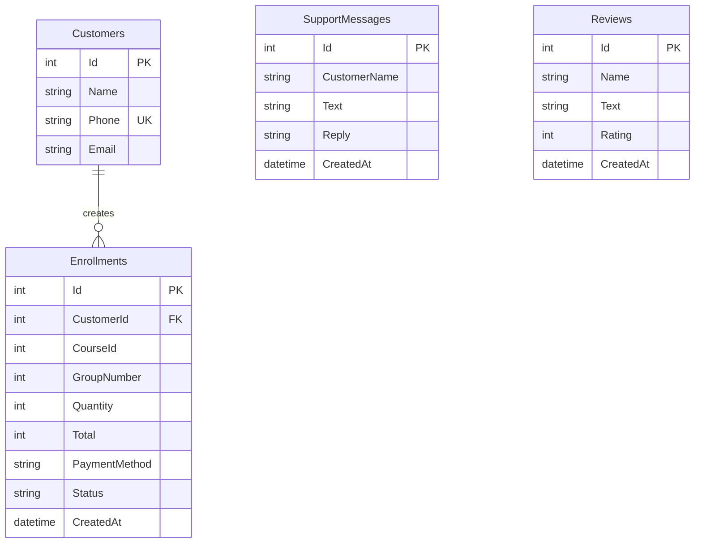

# Материалы к курсовой работе

## Тема и назначение

**Тема:** настольное приложение для записи на занятия театральной студии «Сцена».

**Цель:** разработать приложение, в котором посетитель может выбрать театральную программу и группу, оформить заявку, управлять избранными курсами и обращаться в поддержку; сотрудник студии может просматривать заявки и отвечать на обращения.

**Объект автоматизации:** запись и сопровождение посетителей театральной студии.

**Предмет автоматизации:** каталог программ, расписание групп, клиентские заявки, отзывы и обращения в поддержку.

## 1.4. Обоснование выбора технологических средств

Для каждой задачи рассмотрены альтернативные средства. Выбор обоснован свойствами, которые нужны приложению, а не тем, изучалась ли технология в колледже.

| Задача | Рассмотренные варианты | Выбор и обоснование |
|---|---|---|
| Хранение данных | Microsoft SQL Server, SQLite, PostgreSQL | **Microsoft SQL Server.** Реляционные таблицы и ограничения целостности позволяют хранить клиентов и связанные с ними заявки, отзывы и обращения; транзакции помогают сохранять связанные изменения согласованно. SQL Server Express LocalDB позволяет работать с той же СУБД локально при разработке и демонстрации. Это прямо соответствует заданному стеку. |
| Интерфейс настольного приложения | Avalonia UI, WPF, Windows Forms | **Avalonia UI.** Предоставляет настольные элементы управления и стилизацию для фирменного интерфейса, поддерживает C# и .NET и позволяет собирать приложение для Windows. В проекте интерфейс реализован в Avalonia, а Windows x64 сборка подготовлена для демонстрации. |
| Доступ к данным | Entity Framework Core, ADO.NET, Dapper | **Entity Framework Core.** Сопоставляет классы C# с таблицами SQL Server, предоставляет типизированный `DbContext`, запросы LINQ и сохранение изменений без ручного написания SQL для каждой операции. Это используется для клиентов, заявок, отзывов и обращений. |
| Язык и платформа | C#/.NET, Java, JavaScript с настольной оболочкой | **C# и .NET 10.** C# напрямую используется Avalonia UI и Entity Framework Core, поэтому интерфейс, модели предметной области и доступ к данным можно реализовать в одном типизированном проекте .NET. Это обеспечивает общий технологический стек, указанный в задании. |
| Среда разработки | Visual Studio, Visual Studio Code, JetBrains Rider | **Visual Studio.** Поддерживает проекты .NET, IntelliSense для C#, сборку и отладку настольного приложения, управление NuGet-зависимостями и Git в одном рабочем окружении. Эти возможности нужны для разработки, запуска и демонстрации проекта. |
| Контроль версий и размещение | Git с GitHub, Subversion с удалённым сервером, копирование файлов вручную | **Git и GitHub.** Git хранит историю изменений в коммитах и поддерживает ветки; GitHub хранит удалённую копию репозитория и делает исходный код доступным для проверки. Это позволяет показать ход разработки и передать проект преподавателю по ссылке. |

Таким образом, выбранный стек — **C#, Visual Studio, Avalonia UI, Entity Framework Core, Microsoft SQL Server, Git и GitHub** — закрывает задачи настольного интерфейса, хранения и обработки данных, разработки и контроля версий.

## Архитектура

Приложение построено как настольный клиент с тремя основными слоями:

1. **Представление:** главное окно Avalonia, разделы приложения, карточки курсов и формы.
2. **Модель предметной области:** курсы и сущности `Customer`, `Enrollment`, `SupportMessage`, `StudioReview`.
3. **Хранение:** `StudioDbContext` на Entity Framework Core и база Microsoft SQL Server.

Список курсов и расписание заданы в приложении как справочные данные. Контакты клиентов, заявки, статусы, обращения и отзывы хранятся в SQL Server. Избранное, корзина и контактные данные для следующего запуска сохраняются локально в JSON-файле профиля пользователя Windows.

## Структура базы данных

| Таблица | Назначение | Основные поля |
|---|---|---|
| `Customers` | Контакты клиентов | `Id`, `Name`, `Phone`, `Email` |
| `Enrollments` | Запись клиента на группу | `CustomerId`, `CourseId`, `GroupNumber`, `Quantity`, `Total`, `PaymentMethod`, `Status`, `CreatedAt` |
| `SupportMessages` | Вопросы клиентов и ответы | `CustomerName`, `Text`, `Reply`, `CreatedAt` |
| `Reviews` | Оценки и отзывы | `Name`, `Text`, `Rating`, `CreatedAt` |

Связь `Customers` → `Enrollments` имеет тип «один ко многим»: у одного клиента может быть несколько заявок. В `Enrollments.CourseId` хранится идентификатор курса из справочника приложения; `GroupNumber` указывает выбранную группу.

## Основные пользовательские сценарии

1. Посетитель ищет курс по названию, описанию, педагогу или направлению; сортирует список по цене и сохраняет понравившиеся программы в избранное.
2. Посетитель открывает карточку, выбирает группу и добавляет её в корзину.
3. На оформлении заявки посетитель указывает контакты, выбирает способ оплаты в студии и при желании вводит промокод `SCENA10` или `DEBUT`.
4. Приложение создаёт запись клиента и заявку через Entity Framework Core, сохраняет статус и сумму в SQL Server.
5. В личном кабинете заявки отображаются по номеру телефона; заявку со статусом «Новый» или «Оплачен» можно отменить.
6. Клиент оставляет отзыв или отправляет вопрос. Сотрудник студии видит заявку в административном разделе, меняет статус и отвечает на обращения.

## Запуск и проверка

1. Установить Visual Studio с поддержкой .NET 10 SDK, workload «Разработка классических приложений .NET» и компонент SQL Server Express LocalDB.
2. Выполнить `powershell -ExecutionPolicy Bypass -File .\setup-localdb.ps1`, чтобы подготовить экземпляр `MSSQLLocalDB`.
3. Открыть `ScenaAvalonia.csproj` и проверить строку подключения `ConnectionStrings:Studio` в `appsettings.json`.
4. Собрать проект командой `dotnet build` и запустить его из Visual Studio или `dotnet run`.
5. При первом обращении к разделу с данными EF Core создаёт базу `ScenaStudioCoursework` и таблицы. Скрипт `schema.sql` содержит идемпотентную схему для ручного развёртывания.

Служебная панель открывается через отдельный пункт меню и требует пароль. В ней отображаются заявки, обращения, показатели запусков приложения и журнал последних посещений. В курсовой версии журнал хранится локально в SQL Server LocalDB; неавторизованные посетители отмечаются как гости, а имя появляется после оформления заявки. Инструкция и первичные учётные данные приведены в `ADMIN_PANEL.md`.
6. Вручную проверить поиск, фильтры, избранное, корзину, промокод, создание/отмену заявки, отзывы, поддержку и административное изменение статуса.

Подключение приложения настроено на `(localdb)\MSSQLLocalDB`. Для реальной работы с данными необходим установленный компонент SQL Server Express LocalDB; инструкция находится в `LOCALDB_SETUP.md`. На рабочей среде подготовки LocalDB не обнаружен, поэтому операции базы данных требуют повторной проверки после его установки.

## Публикация исходного кода

Проект размещён в отдельном публичном GitHub-репозитории [Charliej3663/scena-avalonia-coursework](https://github.com/Charliej3663/scena-avalonia-coursework). В нём находятся исходники Avalonia-приложения, документация и ресурсы; каталоги `bin`, `obj`, `.vs` и `publish` исключены через `.gitignore`. Подготовлен отдельный самодостаточный Windows x64 ZIP-пакет; для его запуска не требуется отдельный .NET Runtime, но необходим установленный SQL Server Express LocalDB.

## Ограничения текущей версии

- каталог курсов и расписание являются фиксированным справочником в приложении;
- онлайн-оплата не выполняется: способ оплаты фиксируется в заявке, расчёт производится в студии;
- учебный административный экран не является системой разграничения ролей для публичного промышленного сервиса;
- запуск и публикация ориентированы на Windows x64.

